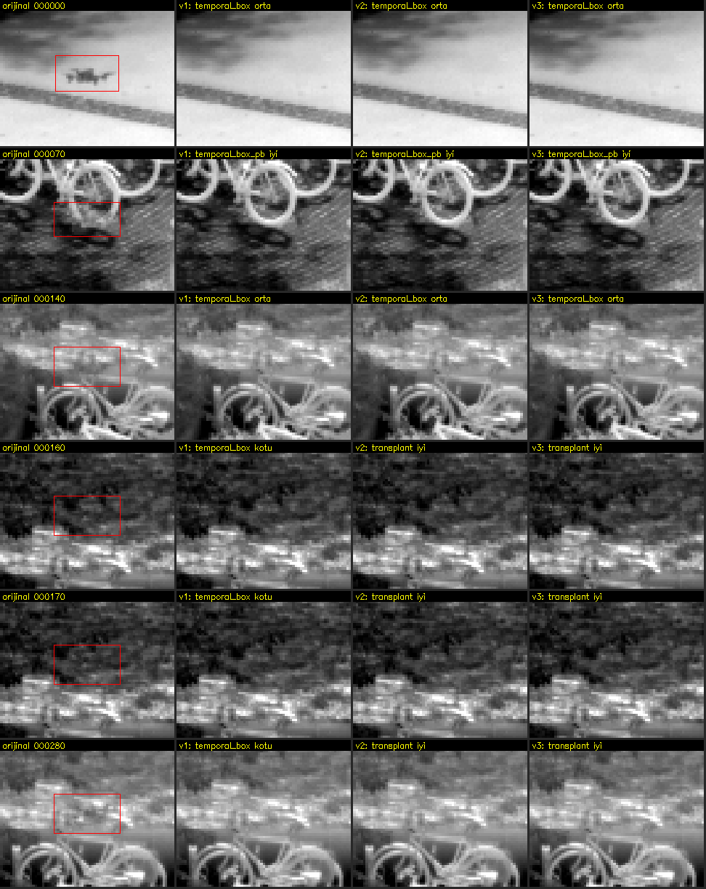
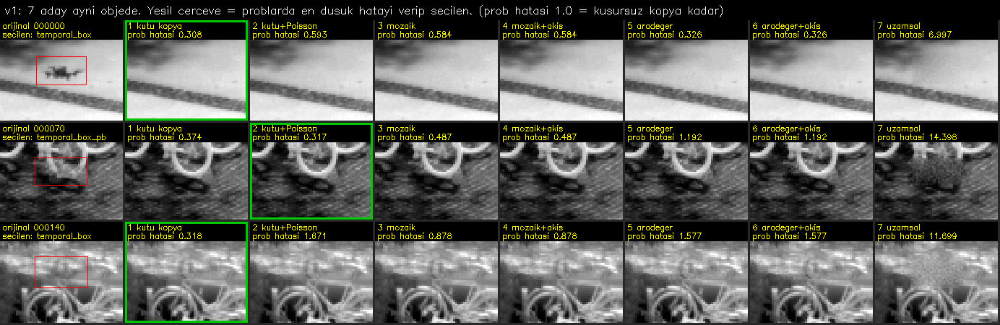
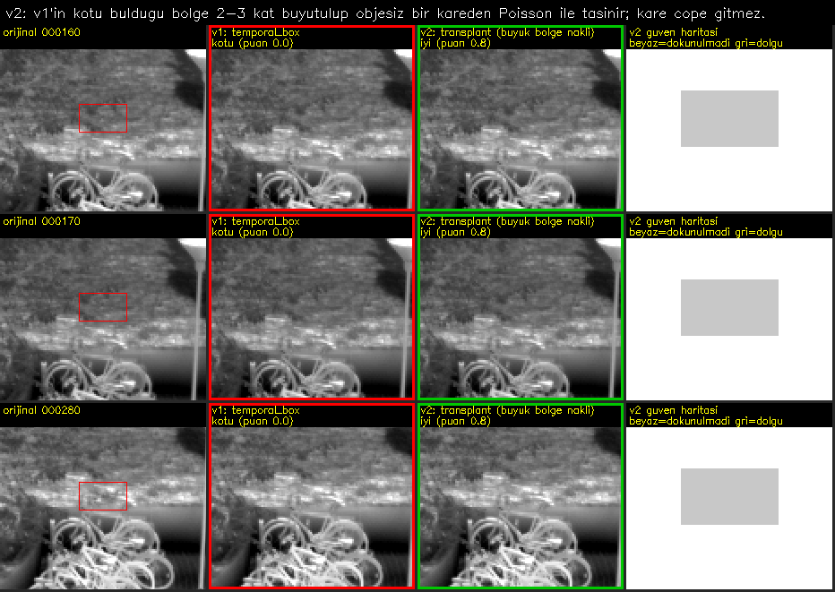
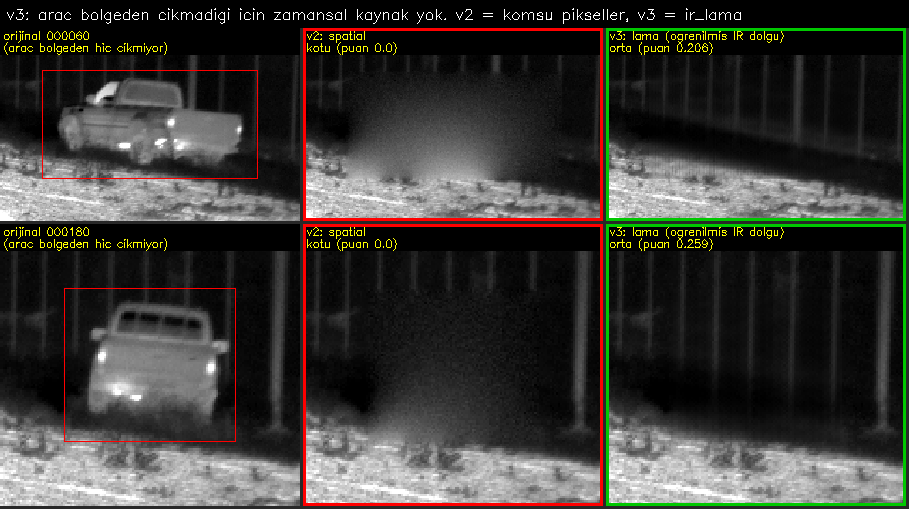

# Sekanstan arka plan üretimi: bg_sequence v1, v2, v3

Sabit kameralı IR dizisinde etiketli objeleri siler, yerlerini arka planla doldurur, her sonucu kendi kendine
puanlar ve kareleri `iyi`, `orta`, `kotu` klasörlerine ayırır. Üç sürüm de tek dosyadır, aynı girdileri alır.

| Sürüm | Ne ekler | Bağımlılık | Ne zaman |
|---|---|---|---|
| `bg_sequence_v1.py` | Temel yöntem: 7 aday, kendi kendini sınama, puanlama | numpy, opencv, scipy | Hızlı ve yeterli |
| `bg_sequence_v2.py` | v1 + kısıtlı büyük bölge nakli + güven haritası | aynı | Veri seti üretimi için önerilen |
| `bg_sequence_v3.py` | v2 + sahneye özel öğrenilen düzeltici + isteğe bağlı ir_lama | + torch | En yüksek kalite, en yavaş |

## Örnek

Gerçek LTIR dron dizisi (300 kare, sabit kamera). Soldan sağa: orijinal (kırmızı kutu silinen bölge), v1, v2, v3.
Bu dizide v1: 22 iyi, 5 orta, 3 kötü; v2 ve v3 kötü kareleri büyük bölge nakliyle kurtardı: 25 iyi, 5 orta, 0 kötü.



### Sürümlerin farkı görsellerle

**v1, 7 aday aynı objede:** her aday objenin yanındaki boş bölgelerde (prob) denenir; yeşil çerçeveli olan
gerçek piksellere en yakın sonucu verip seçilendir.



**v2, büyük bölge nakli:** v1'in kötü bulduğu bölge büyütülüp objesiz bir kareden taşınır; kare çöpe gitmez.
Sağda güven haritası (beyaz dokunulmadı, gri dolgu).



**v3, öğrenilmiş IR dolgu:** obje bölgeden hiç çıkmazsa zamansal kaynak yoktur. v1/v2 yalnız komşu piksellerden
doldurur (bulanık leke), v3 eğittiğimiz `ir_lama` modeliyle doldurur. Bu dizide 10 karenin 2'sinde model seçildi;
kalanlarda araç çok büyük olduğu için o da yetmedi ve kareler `kotu` kaldı.



## Kullanım

```bash
python bg_sequence_v2.py --project "C:\proje" --out "C:\cikti" --preview-every 20
```

```bash
python bg_sequence_v3.py --project "C:\proje" --out "C:\cikti" --lama models/ir_lama.pt
```

Girdiler `bg_clean.py` ile aynıdır: `--project` (TIFF + COCO), ya da `--frames` ile birlikte iki COCO dosyası
veya `--labels` (YOLO klasörü / CSV). 8/14/16 bit korunur, maske dışındaki pikseller değişmez.

| Seçenek | Varsayılan | Ne işe yarar |
|---|---|---|
| `--scales` | `1.0,1.1,1.2,1.3,1.4` | Denenecek etiket büyütmeleri |
| `--margin` | `3` | Obje bir pikselden çıktıktan sonra beklenecek kare (ısıl iz) |
| `--search` | `1000` | Zamansal kaynağın en çok uzaklığı (kare) |
| `--thresholds` | `0.8,0.2` | `iyi` ve `orta` puan eşikleri |
| `--probes` | `4` | Bölge başına sınama bölgesi, azaltmak hızlandırır |
| `--methods` | hepsi | Aday listesi, ör. `interp_flow_pb,mosaic_flow_pb,spatial` |
| `--every N` | `1` | Yalnız her N. kareyi işle (hızlı deneme; kaynak olarak tüm kareler kullanılır) |
| `--workers` | `4` | Paralel süreç sayısı |
| `--preview-every N` | `0` | Her N karede bir yan yana 8 bit önizleme |

## Çıktılar

| Dosya / klasör | İçerik |
|---|---|
| `iyi/`, `orta/`, `kotu/` | `bg_<ad>`: temizlenmiş kareler, orijinal biçim ve bit derinliğinde |
| `silinmemis/` | Orijinal kopyalar (`--no-originals` ile kapatılır) |
| `onizleme/` | Solda orijinal ve bölgeler (renk = kategori, yazı = yöntem ve puan), sağda sonuç |
| `guven/` | (v2, v3) güven haritası: 255 dokunulmamış, 200 iyi, 128 orta, 0 kötü bölge |
| `rapor.csv` | Obje başına: etiket, maske, ölçek, seçilen yöntem, puan, prob hatası, kalıntı, dikiş, tüm adayların hataları |
| `ozet.json` | Kategori ve yöntem sayıları, süre; v3'te düzelticinin doğrulama sonucu |

## Nasıl çalışır

Ana mantık kes-yapıştırdır: obje oradan geçtikten sonra (veya gelmeden önce) görünen gerçek arka plan alınır,
kenarları Poisson (gradyan alanı) birleştirmeyle düzeltilir. Uzamsal dolgu yalnız bir adaydır.

1. **Maske:** Etiketin çevresinde ısı halesinin nerede bittiği ölçülür. İki arka plan modeli denenir: zamansal
   referans (ağaç, zemin gibi sabit doku farkta yok olur) ve tek kareye oturtulan düzlem. Uzak halkalarda daha az
   artık bırakan model kullanılır; yavaş objede referans çok eski karelerden geldiği için bulut değişimi onu
   bozar. Hale objeyle aynı işaretlidir (sıcak obje parlak hale), bu yüzden bulut içindeki karanlık boşluk hale
   sanılmaz. 1.0-1.4 ölçeklerinden haleyi kapsayan en küçüğü seçilir, yetmezse ölçülen genişlik kullanılır.
2. **Adaylar (her bölge için):**
   - `temporal_box` / `temporal_box_pb`: bölgenin tamamen boş olduğu en yakın kareden kopya; `_pb` kenarı Poisson ile düzeltir.
   - `mosaic_pb` / `mosaic_flow_pb`: her piksel kendi açıldığı en yakın kareden, parçalar Poisson ile birleşir;
     `_flow` sürüklenen bulutu optik akışla hizalar (akış, objeden 16 piksel uzaktaki piksellerin medyanıdır).
   - `interp_pb` / `interp_flow_pb`: obje gelmeden önceki son ve gittikten sonraki ilk görüntünün zamana göre
     ağırlıklı ortalaması; yavaş değişen bulutta değişim birbirini götürür. Ortalamanın sildiği gürültü geri eklenir.
   - `spatial`: yalnız komşu piksellerden harmonik dolgu + sensör gürültüsü.
3. **Seçim (kendi kendini sınama):** Bölgenin yanında objesiz, aynı biçimli prob bölgeleri maskelenir, her aday
   onları da doldurur ve gerçek piksellerle karşılaştırılır. Proba objenin zaman içindeki doluluğu aktarılır
   (aday probda da aynı zaman uzaklığına gitmek zorunda kalır). Problar çevresi bölgeninki kadar yapılı yerlerden
   seçilir; bölge probdan daha yapılıysa (bulut kenarı) prob hatası orantılı büyütülür. Uzamsal dolgu ayrıca
   bölgenin kendi yerinde, objenin oradan çekildiği karede sınanır.
4. **Doku denetimi:** Seçilen dolgu çevresinde olmayan ince doku taşıyorsa (uzak kareden farklı bulut parçası)
   sıradaki adaya geçilir.
5. **Puan ve kategori:** Dört ölçütün en zayıfı alınır: prob hatası, kalıntı (objeyle aynı işaretli iz ve maske
   dışında kalan hale), dikiş, doku uyumu. Karedeki en kötü bölge karenin kategorisini belirler.

**v2:** Kusurlu (kalıntı/dikiş) bölge 2-3 kat büyütülüp tamamen boş bir kareden Poisson ile taşınır; bağışçının
pencere kenarı mevcut kareyle gürültü düzeyinde uyuşmuyorsa yapılmaz, nakil puanı 0.8 ile sınırlıdır. Güven haritası
tek bir kötü obje yüzünden karenin tamamen çöpe gitmemesi içindir: eğitimde 0 olan yerler yok sayılabilir.

**v3:** Dizinin bir alt kümesindeki problarla küçük bir U-Net bu sahnede "aday dolgu → gerçek piksel" düzeltmesini
öğrenir; yalnız ayrılmış doğrulama problarında ve o bölgenin problarında hatayı düşürüyorsa kullanılır (yöntem adına
`+duzeltici` eklenir). `--lama models/ir_lama.pt` ile zamansal adaylar zayıf kaldığında öğrenilmiş uzamsal dolgu da aday olur.

## Test sonuçları

Gerçek arka planı bilinen deneme düzeneği: 600 kare, gerçek LTIR zemin dokusu + sürüklenen ve biçim değiştiren
sentetik bulutlar + haleli 5 obje. Hata = sonucun gerçek arka plandan farkı / komşu iki gerçek kare arasındaki fark
(1.0 = kusursuz kopya kadar iyi). Medyan / %90 değerleri:

| Obje (hız) | bg_clean | v1 son |
|---|---|---|
| hızlı kuş (3,2 px/kare) | - | 0.80 / 1.47 |
| orta dron (1 px/kare) | - | 1.04 / 2.27 |
| yavaş insan (0,3 px/kare, dokulu zemin) | - | 1.80 / 3.33 |
| yavaş dron (0,23 px/kare, bulut) | - | 3.67 / 5.91 |
| çok yavaş dron (0,1 px/kare, bulut) | - | 2.97 / 24.4 |
| **tümü** | **2.53 / 25** | **1.51 / 5.56** |

Puanın güvenilirliği (v1, 1500 obje): gerçekte kötü olanların (hata > 3) %74'ü `kotu`, %6'sı `iyi` çıktı; `iyi`
çıkan gerçek-kötülerin çoğu dokulu zeminde gözle fark edilmeyen sapmalar. v2 ve v3 bir önceki turda v1'den
biraz daha iyiydi (tümü medyan 1.56 ve 1.54, v1 o turda 1.64); son v1 düzeltmeleri v2 ve v3'te de var.

Birim testleri (8/14/16 bit, maske dışı değişmiyor, RGBA, kenardaki obje, COCO/YOLO/CSV eşitliği): v1 ve v2 son
halde geçti; v3 son halinin testi süre yüzünden yarıda kesildi, bir önceki v3 hali geçmişti.

## Bilinen sınırlar

- **Kamera sabit olmalı.** Hareketli kamerada kaynaklar yanlış yere oturur.
- **Değişen bulut önünde çok yavaş obje en zor durumdur.** Arka plan açılana kadar bulut biçim değiştirir; sonuç
  doğal görünse de gerçekten farklıdır (aşağıda hata 3-4 kat). Puan bunu çoğunlukla `kotu` olarak işaretler.
- **Dizinin başında/sonunda yavaş obje:** Arka plan yalnız bir yönden açılır, bu karelerin çoğu `kotu` çıkar.
- **Etiketsiz objeler** kaynak karelerden kopyalanabilir; sahnedeki tüm objeler etiketli olmalı.
- **Puan bir tahmindir,** bilerek temkinli ayarlandı: gerçekte iyi olan bir kısım `orta`/`kotu`ya düşer.
- **Paketli 14 bit TIFF okunmaz,** 16 bitlik kapsayıcı gerekir.
- **Hız:** 640×512 karede obje başına yaklaşık 0,1-0,2 saniye (6 süreç). v3'e düzeltici eğitimi için birkaç dakika eklenir.

## Model

`models/ir_lama.pt`: big-lama'dan IR görüntülere ince ayarlanmış inpainting modeli (TorchScript, Git LFS ile).
v3'te `--lama models/ir_lama.pt` ile uzamsal aday olarak kullanılır. Eğitim ayarları ve doğrulama sonuçları
`models/ir_lama.json` dosyasındadır (6000 adım, batch 4, lr 1e-5; LLVIP, LTIR ve AAU RainSnow çiftleri).

Kurulum:

```bash
git lfs install
pip install -r requirements.txt
```
